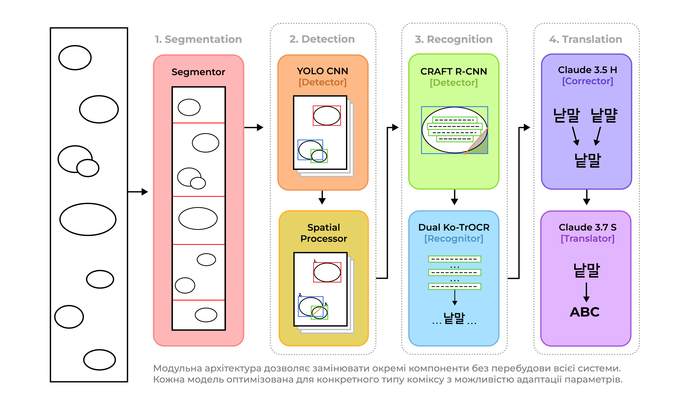
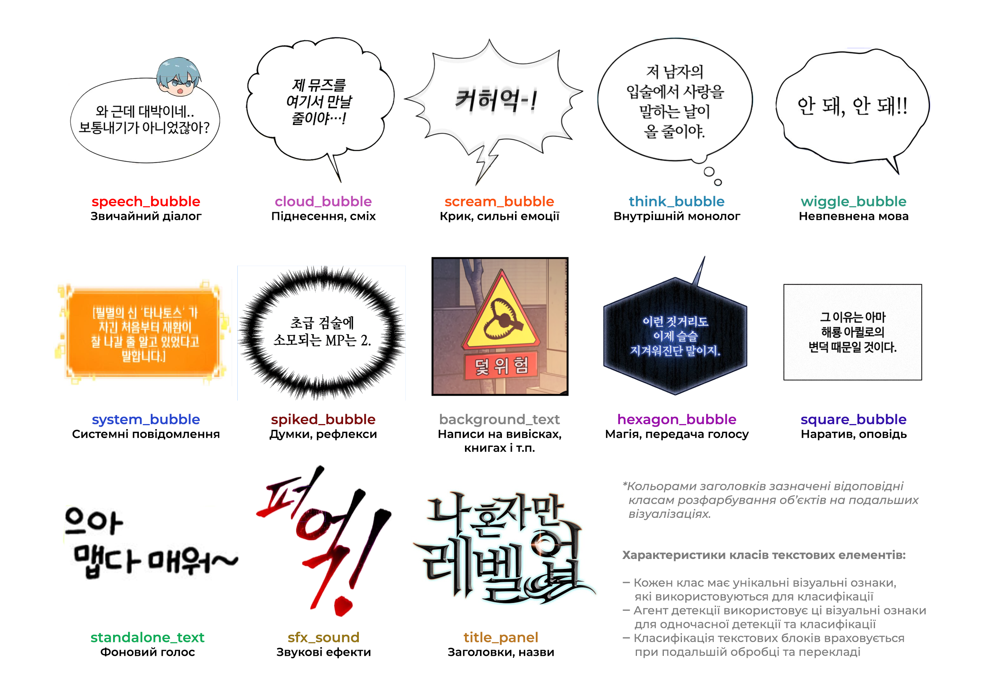
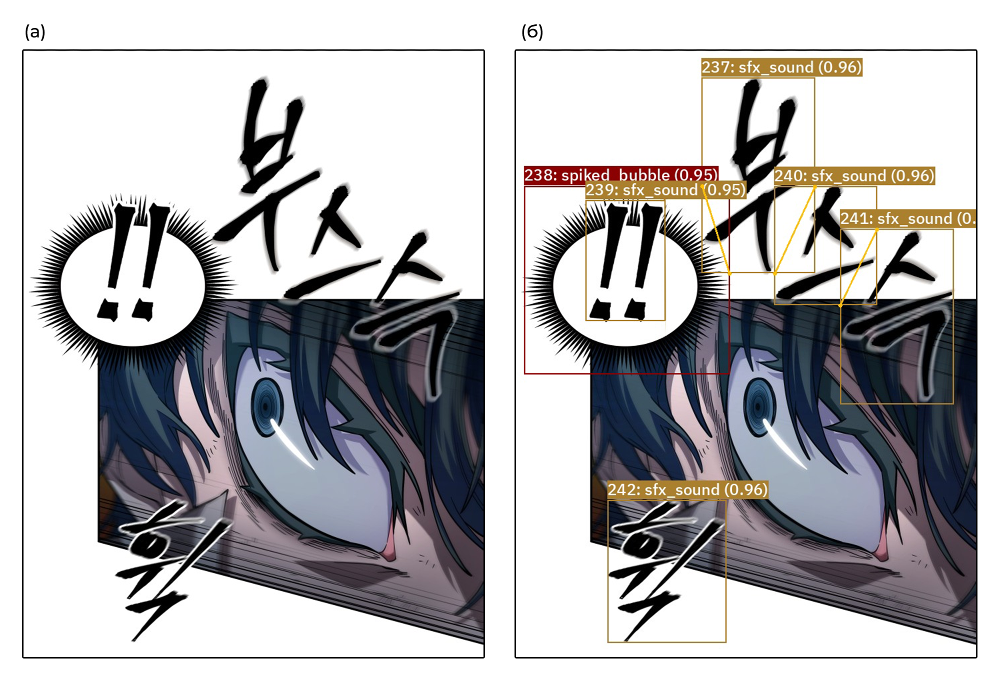
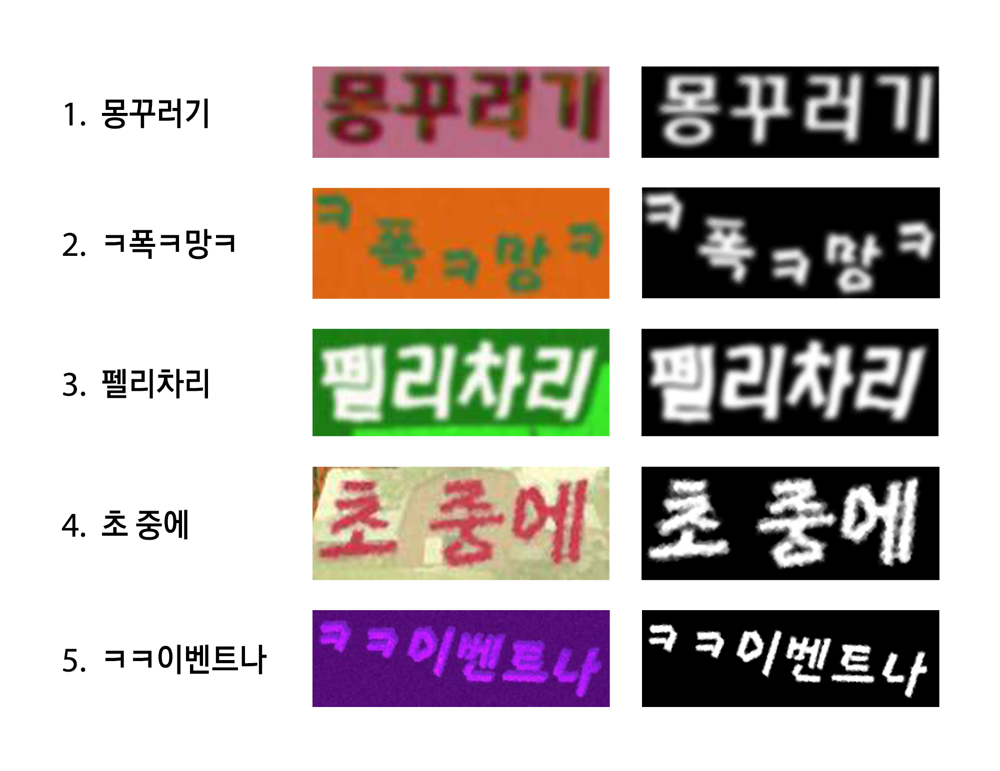
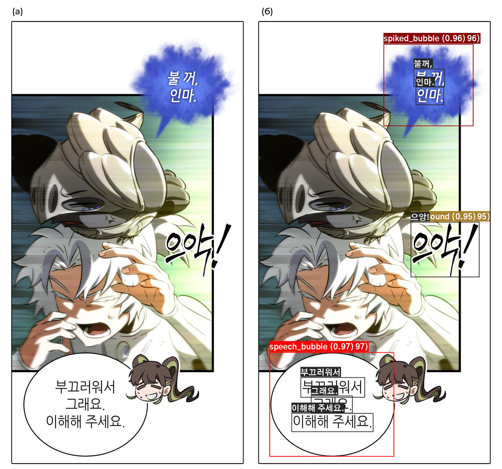

# ComicGlot: Intelligent System for Segmentation and Stylized Translation of Hieroglyphic Text in Multimedia Comics

[](https://opensource.org/licenses/MIT)
[](https://www.python.org/downloads/)

ComicGlot is an end-to-end intelligent system for automated segmentation, recognition, and stylized translation of Asian comics (manga, manhwa, manhua). The system addresses a critical challenge in comic localization: preserving the stylistic and emotional context of text while translating between dramatically different writing systems.

Unlike conventional OCR and translation pipelines, ComicGlot integrates bubble classification, specialized hieroglyphic text recognition, and context-aware translation to maintain the artistic integrity of the original content. This approach enables faster, higher-quality localization of comics while retaining their distinctive visual storytelling elements.



## 📋 Table of Contents

- [Installation](#installation)
- [Quick Start](#quick-start)
- [Project Structure](#project-structure)
- [Usage Examples](#usage-examples)
- [Technical Details](#technical-details)
- [Training Your Own Models](#training-your-own-models)
- [Contributing](#contributing)
- [Citation](#citation)
- [License](#license)

## 🔧 Installation

ComicGlot requires Python 3.8+ and benefits significantly from GPU acceleration for production use.

### Setup

```bash
# Clone the repository
git clone https://github.com/0LuminaX0/ComicGlot.git
cd comicglot

# Create and activate a virtual environment
python -m venv venv
source venv/bin/activate  # On Windows: venv\Scripts\activate

# Install dependencies
pip install -r requirements.txt

# Install the package in development mode
pip install -e .
```

### Environment Configuration

ComicGlot uses environment variables for API keys and model paths. Copy the example file and configure accordingly:

```bash
cp .env.example .env
```

## 🚀 Quick Start

ComicGlot can be used programmatically or via command-line tools.

### Processing a Single Image

```python
from comicglot.comic_processor import ComicProcessor

processor = ComicProcessor()
results = processor.process_image("path/to/comic_image.jpg")
processor.save_results(results, "path/to/output")
```

### Processing an Entire Chapter

```bash
python -m comicglot.scripts.process_chapter --input path/to/chapter --output path/to/output
```

## 📂 Project Structure

ComicGlot employs a modular architecture where each component addresses a specific challenge in comic localization:

```
comicglot/
├── comic_processor/ # Core processing workflow orchestration
├── detection/       # Text bubble detection and classification
├── recognition/     # OCR specialized for hieroglyphic text
├── translation/     # Context-aware stylized translation 
└── utils/           # Common utilities and helper functions
```

Each module is designed to work independently or as part of the integrated pipeline. This architecture allows for flexibility in deployment and customization while maintaining a coherent workflow. Detailed documentation for each component is available in their respective directories.

## 📚 Usage Examples

ComicGlot offers a comprehensive API that can be used either as an integrated pipeline or as individual components for specific tasks.

### Complete Pipeline

The pipeline integrates detection, recognition, and translation in a single workflow:


```python
from comicglot.comic_processor import ComicProcessor

processor = ComicProcessor(
    detection_model="yolo",
    recognition_model="trocr-korean",
    translator="claude",
    source_lang="ko",
    target_lang="en"
)

processor.process_chapter(
    input_dir="path/to/chapter",
    output_dir="path/to/output",
    save_intermediates=True  # Useful for debugging
)
```

### Component-Specific Usage

Each component can be used independently for targeted tasks:

#### Text Bubble Detection

```python
from comicglot.detection import YOLODetector

detector = YOLODetector(model_path="path/to/model.pt")
bubbles = detector.detect("path/to/image.jpg")

for bubble in bubbles:
    print(f"Class: {bubble.class_name}, Confidence: {bubble.confidence}")
    print(f"Coordinates: {bubble.box}")
```

#### Text Recognition

```python
from comicglot.recognition import OCRProcessor
from PIL import Image

ocr = OCRProcessor(language=["ko"])

image = Image.open("path/to/bubble.jpg")
text = ocr.recognize(image)
print(f"Recognized text: {text}")
```

#### Stylized Translation

```python
from comicglot.translation import LLMTranslator

translator = LLMTranslator(
    source_lang="ko", 
    target_lang="en",
    style_preservation=True
)

translated = translator.translate(
    text="안녕하세요!!!",
    bubble_type="scream_bubble",
    context=["이전 대화...", "또 다른 대화..."]
)

print(f"Stylized translation: {translated}")
```


## 🔬 Technical Details

ComicGlot's approach is distinguished by its specialized components working in concert to address the unique challenges of comic localization.

### Bubble Detection and Classification

The system employs YOLOv12 with custom training to identify 13 distinct text bubble types based on visual characteristics. This fine-grained classification is crucial for preserving the emotional and narrative context in translation.



The detection model achieves over 86% mAP50 on test datasets, reliably identifying various bubble types including standard speech, thought bubbles, exclamations, sound effects, and narrative text. This classification serves as the foundation for the downstream stylistic processing.



### Synthetic Data Generation for TrOCR Training

The OCR system relies on synthetic data generation to create training examples without requiring manual annotation. Using the CC-100 corpus with 5.6 billion Korean tokens as a text source, the system leverages an extended version of the SynthTIGER framework to generate over 2 million training images. These images incorporate varied comic-specific fonts, styles, and visual treatments that match the different text presentations found in manhwa. This approach allows the model to recognize both standard and highly stylized text with significantly lower error rates compared to generic OCR solutions.



### Hieroglyphic Text Recognition

Comic text recognition presents unique challenges due to artistic fonts, variable layouts, and stylized characters. ComicGlot uses a dual TrOCR architecture:

1. A "strict" model optimized for standard text with high precision
2. A "flexible" model designed to handle artistic and unusual fonts

This dual approach achieves Character Error Rates (CER) below 5% on typical manhwa fonts while maintaining robustness to stylistic variations. The system also incorporates CRAFT (Character Region Awareness For Text Detection) to handle complex text layouts within bubbles.



### Context-Aware Stylized Translation

Translation in ComicGlot goes beyond simple text conversion to preserve stylistic elements:

1. Context windows maintain narrative coherence across sequential bubbles
2. Bubble-type-specific prompting guides Large Language Models (Claude 3.7 and Qwen) to maintain appropriate emotional tone
3. Specialized handling for sound effects and onomatopoeia, which often require creative adaptation rather than literal translation

At the end you get the full processed JSON logging file, which can be further utilised in work:

```json
    {
      "id": 0,
      "image_path": "data\\output\\comicglot_run24\\segments\\segment_001.png",
      "source_image": "data\\chapters\\4\\01.png",
      "blocks": [
        {
          "id": 0,
          "frame_id": 0,
          "box": [
            57.699745178222656,
            7.908215522766113,
            634.5813598632812,
            499.9194030761719
          ],
          "class_name": "speech_bubble",
          "confidence": 0.9790289402008057,
          "separators": null,
          "source_image": "data\\chapters\\4\\01.png",
          "text": "나 약속 치켰어요, 초보자님.",
          "text_lines": [
            {
              "box": [
                128,
                150,
                560,
                238
              ],
              "text": "나 약속 치켰어요,"
            },
            {
              "box": [
                224,
                231,
                456,
                309
              ],
              "text": "초보자님."
            }
          ],
          "secondary_text": "나 약속 지켰어요, 초보자님.",
          "corrected_text": "나 약속 지켰어요, 초보자님.",
          "translated_text": "I kept my promise, rookie."
        }
      ],
      "num_blocks": 1
    },
...
```

## 🧠 Training Your Own Models

ComicGlot supports customization for specific comics or languages. See [training/README.md](training/README.md) for comprehensive instructions on:

- Training bubble detection models with domain-specific data
- Fine-tuning OCR models for particular comic styles or languages
- Optimizing translation prompts for specific target languages

## Contributing

Contributions to improve ComicGlot are welcome. If needed - please consult for development guidelines, code standards, and contribution workflow.

## Citation

If you use ComicGlot in your research, please cite:

```bibtex
@misc{negrub2025comicglot,
  author = {Negrub, Andrii S.},
  title = {ComicGlot: Intelligent System for Segmentation and Stylized Translation 
           of Hieroglyphic Text in Multimedia Comics},
  year = {2025},
  howpublished = {\url{https://github.com/0LuminaX0/ComicGlot}}
}
```

## License

This project is licensed under the MIT License - see the [LICENSE](LICENSE) file for details. The NN classifier in this repository may have been trained using publicly accessible content from various sources. So, if provided - detection models are used for research and educational purposes only. 

### Important Legal Notes:

1. **No Endorsement**: This project is not affiliated with, endorsed by, or connected to any content providers whose material may have been used during training.

2. **No Redistribution of Content**: This repository does not contain or redistribute any copyrighted content. Only the trained model parameters may be included.

3. **Takedown Policy**: If you are a copyright holder and believe this project uses your content in a way that constitutes copyright infringement, please contact us. We are committed to promptly addressing legitimate concerns by:
   - Removing specific model weights upon valid request
   - Retraining models without the contested content
   - Taking other reasonable measures to address valid legal concerns

4. **User Responsibility**: Users of this model are responsible for ensuring their own compliance with applicable laws and terms of service.

## Acknowledgements

ComicGlot builds upon several open-source projects and research:

- [Team Lucid](https://github.com/team-lucid) for the Korean TrOCR model
- [Ultralytics](https://github.com/ultralytics/ultralytics) for the YOLO implementation
- [CRAFT](https://github.com/clovaai/CRAFT-pytorch) text detection model by Clova AI
- [Anthropic](https://www.anthropic.com/) for the Claude API used in translation

